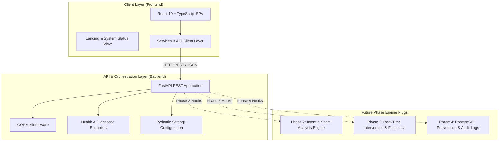

# PAYGUARD AI — System Architecture

**Document Version:** 1.0.0  
**Phase:** Phase 1 — Project Architecture, Environment Setup & Application Foundation  
**System Classification:** Fintech Fraud Prevention & Payment Intervention Prototype  
**Target:** Visionet Talent Quest 2026 – Techthon  

---

## 1. Executive System Overview

PAYGUARD AI is an **Intent-Aware Real-Time Financial Scam Prevention and Payment Intervention System**. Traditional fraud systems primarily inspect superficial transactional metadata (amounts, velocities, geographic discrepancies). PAYGUARD AI introduces a multi-tier behavioral and semantic intent-scoring paradigm designed to identify social engineering, authorized push payment (APP) scams, cognitive manipulation, and high-coercion payment flows *before* irrevocable fund transfers occur.



---

## 2. Frontend Architecture

### 2.1 Technology Stack
- **Framework:** React 19 with TypeScript in Strict Mode (`strict: true`, `noImplicitAny: true`)
- **Build Tool:** Vite for fast Hot Module Replacement (HMR) and optimized Rollup bundling
- **Styling:** Tailwind CSS for modular utility-first styling and theme tokens
- **Icons:** Lucide React (or lightweight SVG icons)

### 2.2 Directory Structure
The frontend is organized strictly by separation of concerns:
```
frontend/
├── src/
│   ├── assets/              # Static media, icons, and illustrations
│   ├── components/          # Reusable dumb/presentational UI components
│   │   ├── common/          # Buttons, Cards, Badges, Modals
│   │   └── layout/          # Navbar, Footer, App Shell
│   ├── pages/               # Route-level views (Landing, Future Dashboard)
│   ├── layouts/             # Page structural layouts (MainLayout)
│   ├── services/            # API clients, HTTP wrappers, service adapters
│   │   ├── api.ts           # Base HTTP client with error handling
│   │   └── healthService.ts # Health check & telemetry integration
│   ├── types/               # TypeScript interfaces, DTOs, and domain models
│   ├── App.tsx              # Root application router and shell
│   ├── main.tsx             # Application DOM mounting point
│   └── index.css            # Global CSS styles and Tailwind directives
├── vite.config.ts           # Vite bundler configuration
└── tsconfig.json            # Strict TypeScript compiler configuration
```

### 2.3 Frontend State & Communication Design
- **Stateless Service Abstraction:** Network requests are isolated within `services/` modules using typed Axios/Fetch abstractions.
- **Fail-Safe UI Feedback:** Components explicitly render loading, error, and healthy diagnostic states when interacting with backend services.
- **Strict Typing:** All payload responses are mapped to immutable TypeScript interfaces before component rendering.

---

## 3. Backend Architecture

### 3.1 Technology Stack
- **Language / Runtime:** Python 3.12+ (tested on Python 3.13 runtime)
- **Framework:** FastAPI with asynchronous ASGI execution
- **Validation & Settings:** Pydantic v2 & Pydantic-Settings
- **Server:** Uvicorn ASGI server
- **Testing:** Pytest with HTTPX AsyncClient

### 3.2 Directory Structure
The backend adheres to a modular structure avoiding monolithic coupling:
```
backend/
├── app/
│   ├── __init__.py          # Package metadata
│   ├── main.py              # Application factory, lifespan, CORS, error handling
│   ├── api/
│   │   ├── __init__.py
│   │   └── routes/
│   │       ├── __init__.py
│   │       └── health.py    # GET /health & GET /api/v1/health endpoints
│   └── core/
│       ├── __init__.py
│       └── config.py        # Centralized Pydantic configuration & env loading
├── tests/
│   ├── __init__.py
│   └── test_health.py       # Automated integration test suite with HTTPX
├── requirements.txt         # Pinned dependency definitions
└── venv/                    # Isolated Python virtual environment
```

### 3.3 Core Design Patterns
1. **Application Factory (`create_application`):** Encapsulates route attachment, middleware configuration, and lifecycle event binding to enable clean programmatic testing.
2. **Centralized Configuration (`core/config.py`):** Uses Pydantic `BaseSettings` with automatic `.env` reading, case-sensitive variable validation, and typed defaults.
3. **Structured Error Handling:** A global ASGI exception handler intercepts unhandled exceptions and formats standard JSON error envelopes without exposing internal stack traces in production.
4. **CORS Governance:** Configurable origin whitelisting enables local frontend development while disallowing arbitrary wildcard cross-origin attacks.

---

## 4. API Communication Specification

### 4.1 Health Check Protocol

#### `GET /health`
- **Purpose:** Primary diagnostic endpoint for infrastructure health checks and orchestration probes.
- **Request Headers:** None required.
- **Response Status:** `200 OK`
- **Response Body:**
  ```json
  {
    "status": "ok",
    "service": "payguard-api"
  }
  ```

#### `GET /api/v1/health`
- **Purpose:** Versioned mirror endpoint confirming API gateway routing and v1 namespace validity.
- **Response Status:** `200 OK`
- **Response Body:**
  ```json
  {
    "status": "ok",
    "service": "payguard-api"
  }
  ```

---

## 5. Future AI Modules (Roadmap Preview)

The PAYGUARD AI pipeline is designed for pluggable inference engines in upcoming phases:

```
[ Incoming Payment Context / Chat Transcripts / SMS ]
                       │
                       ▼
┌───────────────────────────────────────────────┐
│     Phase 2: Intent & Scam Semantic Scorer   │
│  - Cognitive manipulation & urgency detector │
│  - Impersonation pattern matching            │
│  - Beneficiary anomaly scoring               │
└──────────────────────┬────────────────────────┘
                       ▼
┌───────────────────────────────────────────────┐
│     Phase 3: Real-Time Intervention Engine   │
│  - Dynamic friction scoring (Low/Med/High)   │
│  - Adaptive cognitive challenge triggers     │
│  - Coercion-breaker timeouts & warnings      │
└───────────────────────────────────────────────┘
```

1. **Intent Analysis Engine:** Analyzes natural language context surrounding transactions (social engineering prompts, urgency triggers, impersonation keywords) using lightweight transformer embeddings and rule heuristics.
2. **Behavioral Sequence Scorer:** Tracks rapid deviations in typical user payee patterns without relying on sensitive customer bank credentials.
3. **Adaptive Intervention Engine:** Calculates a calibrated scam probability score and triggers dynamic friction levels (frictionless pass, cognitive cooling-off pause, biometric second-factor, or transfer hold).

---

## 6. Future Database Integration (Roadmap Preview)

- **Engine:** PostgreSQL 16+ via SQLAlchemy 2.0 (asyncpg driver) and Alembic migrations.
- **Storage Boundaries:**
  - `transactions`: Synthetic transaction ledger and simulated payment events.
  - `interventions`: Audit log of triggered cognitive friction challenges and user responses.
  - `audit_logs`: Immutable trail of scam detection decisions for model explainability.
- **Security & Privacy:** No real customer data, live bank account numbers, or real credentials will ever be persisted. Synthetic UUIDs and pseudorandom tokens will represent accounts in development.
