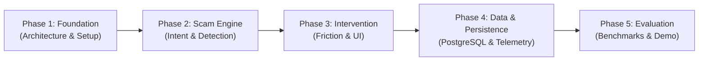

# PAYGUARD AI — Development Plan

**Project:** PAYGUARD AI  
**Competition:** Visionet Talent Quest 2026 – Techthon  
**Product:** Intent-Aware Real-Time Financial Scam Prevention and Payment Intervention System  

---

## Overview

The PAYGUARD AI development roadmap is structured into modular, strictly staged phases. Each phase establishes demonstrable, testable capabilities before introducing subsequent layers.

---

## Phase 1: Project Architecture, Environment Setup & Application Foundation (CURRENT)

**Status:** Completed  
**Objective:** Establish production-ready project topology, configure modern development environments for React/Vite/Tailwind and FastAPI, and deliver verifiable health diagnostics.

- [x] Inspect local runtime environment (Node.js, npm, Python, Git).
- [x] Scaffold structured repository topology (`frontend/`, `backend/`, `docs/`, `data/synthetic/`).
- [x] Initialize React + TypeScript + Vite frontend with Tailwind CSS.
- [x] Implement frontend folder structure (`components`, `pages`, `layouts`, `services`, `types`).
- [x] Build branded PAYGUARD AI landing page with live backend health verification widget.
- [x] Configure backend virtual environment (`backend/venv`).
- [x] Implement FastAPI application factory with CORS middleware and structured error handling.
- [x] Expose `GET /health` returning standard service diagnostic JSON.
- [x] Implement automated pytest integration tests using HTTPX.
- [x] Establish secure environment variables template (`.env.example`) and comprehensive `.gitignore`.
- [x] Deliver architectural and development roadmap documentation.

---

## Phase 2: Intent-Aware Scam Detection Engine

**Status:** Planned (Requires Phase 1 signoff)  
**Objective:** Develop the core semantic intent analysis and scam probability scoring logic.

- [ ] Define synthetic scam taxonomy:
  - Impersonation (Executive/Bank official/Government authority)
  - Urgency & Coercion (Threat of account freeze, immediate deadline)
  - High-risk investment & lottery schemes
  - Romance and emotional manipulation patterns
- [ ] Build natural language intent analysis service:
  - Tokenization, keyword extraction, and heuristic rule engines
  - Semantic similarity scoring against known scam patterns
- [ ] Develop transaction anomaly scorer:
  - Velocity checks, anomalous transfer amounts, new beneficiary ratios
- [ ] Implement Composite Risk Scoring API:
  - `POST /api/v1/analyze`: Accepts transaction context and contextual communication metadata
  - Returns unified scam risk score (0.00 – 1.00), risk tier (`LOW`, `MEDIUM`, `HIGH`, `CRITICAL`), and identified risk indicators.
- [ ] Write unit and scenario tests for detection algorithms with synthetic scam matrices.

---

## Phase 3: Real-Time Payment Intervention & Dynamic Friction UI

**Status:** Planned  
**Objective:** Transform passive detection into active scam disruption through contextual interventions.

- [ ] Implement adaptive friction framework in frontend:
  - Low Risk: Frictionless standard approval flow
  - Medium Risk: Contextual warning banners and verified recipient validation
  - High Risk: Cognitive challenge (cooldown timer, educational reflection questions, "break the spell" verification steps)
  - Critical Risk: Payment freeze and advisor review recommendation
- [ ] Build interactive Scam Simulation Studio in frontend:
  - Pre-loaded interactive scenarios (e.g., "Urgent Tax Authority Scam", "Family Emergency Transfer")
  - Real-time scoring visualizer showing how intent indicators affect the risk score
- [ ] Provide explainable risk breakdowns (e.g., "High urgency detected", "Unusual transfer time", "Recipient account created today").

---

## Phase 4: Data Persistence, PostgreSQL Integration & Audit Logging

**Status:** Planned  
**Objective:** Integrate relational persistence for simulated transactions and compliance audit logs.

- [ ] Configure PostgreSQL database connection using SQLAlchemy 2.0 (asyncpg) and Alembic.
- [ ] Implement database schemas:
  - `synthetic_transactions`: Simulated payment records
  - `scam_assessments`: Record of analyzed risks and scores
  - `interventions`: Log of presented friction modals and user responses
- [ ] Expose analytics endpoints:
  - `GET /api/v1/metrics`: Summary of simulated attacks thwarted, average intervention response times, and scam distribution.
- [ ] Add database seeding scripts using synthetic financial data.

---

## Phase 5: Verification, Benchmarking & Demo Hardening

**Status:** Planned  
**Objective:** Validate end-to-end performance, accuracy on synthetic benchmarks, and polish prototype demonstration.

- [ ] Run benchmark evaluation against synthetic dataset:
  - Measure true positive rate, false positive rate, and latency.
- [ ] Performance optimization: Ensure end-to-end analysis latency remains under 200ms.
- [ ] Build final competition demo showcase with guided walkthrough mode.
- [ ] Final security review, dependency audit, and code quality verification.
